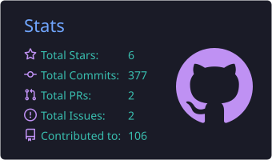
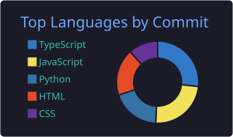
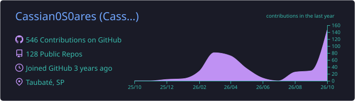

<!-- Header -->

  

<!-- Contatos -->

  
  
  
  

---

## 🧑‍💻 Sobre mim

Sou **Técnico em Desenvolvimento de Sistemas** pelo SENAI Cruzeiro e graduando em **Análise e Desenvolvimento de Sistemas** pela Faculdade SENAI Taubaté. Atualmente atuo como **estagiário de desenvolvimento na IMEX Solutions**, com foco na digitalização de processos, no desenvolvimento de aplicações web e na administração da infraestrutura de servidores.

Tenho experiência prática em todo o ciclo de desenvolvimento de software, da modelagem de dados ao deploy em produção, e atuo na integração de inteligência artificial a processos corporativos.

- 🔭 Atualmente: sistemas em Django, ERP em React e **VPS Linux com 5 sites em produção**
- 🤖 Em desenvolvimento: integração de **IA** a processos de negócio
- 🌱 Em estudo: **arquitetura de sistemas**, **computação em nuvem** e **redes**
- 💬 Áreas de interesse: **Python, JavaScript, PHP, APIs e Linux**
- 🌎 Idiomas: português (nativo) e inglês (avançado)

 

---

## 💼 Experiência

<table align="center">
  <tr>
    <td width="50%" valign="top">
      <h3>🏭 IMEX Solutions</h3>
        
      Desenvolvimento e manutenção de sistemas web para <b>gestão de válvulas industriais e propostas comerciais</b> em Django, incluindo modelagem de dados, CRUD e geração automática de folhas de dados técnicas em PDF. Manutenção do <b>ERP em React</b>, administração da <b>VPS</b> corporativa, integração de <b>IA</b> aos processos internos e suporte técnico aos usuários.
    </td>
    <td width="50%" valign="top">
      <h3>🎓 DG Consultoria</h3>
        
      Desenvolvimento, em equipe, de uma plataforma de <b>venda de cursos online</b> com autenticação, confirmação de e-mail e pagamentos via <b>Stripe</b>, utilizando Laravel, MySQL, HTML e CSS.
    </td>
  </tr>
</table>

---

## 🛠️ Tecnologias e Ferramentas

<table align="center">
  <tr>
    <td align="center" width="170"><b>💻 Linguagens</b></td>
    <td></td>
  </tr>
  <tr>
    <td align="center"><b>🎨 Frontend</b></td>
    <td> </td>
  </tr>
  <tr>
    <td align="center"><b>⚙️ Backend</b></td>
    <td></td>
  </tr>
  <tr>
    <td align="center"><b>🗄️ Banco de Dados</b></td>
    <td></td>
  </tr>
  <tr>
    <td align="center"><b>☁️ Infra & DevOps</b></td>
    <td></td>
  </tr>
  <tr>
    <td align="center"><b>🎮 Games & Dados</b></td>
    <td> </td>
  </tr>
</table>

---

## 📂 Projetos em Destaque

<table align="center">
  <tr>
    <td width="50%" valign="top">
      <h3>⚙️ Gestão de Válvulas Industriais</h3>
      
Sistema corporativo que substituiu o controle em planilhas, abrangendo cadastro técnico de válvulas, propostas comerciais e geração automática de folhas de dados em PDF, com apoio de inteligência artificial.

      
      
      
      
    </td>
    <td width="50%" valign="top">
      <h3>🤖 Chatbot com IA (Low-Code)</h3>
      
Plataforma que permite a criação de fluxos de atendimento inteligentes por meio de blocos visuais, sem necessidade de conhecimento técnico. Desenvolvida como Trabalho de Conclusão do Curso Técnico.

      
      
      
    </td>
  </tr>
  <tr>
    <td colspan="2" valign="top">
      <h3>🎓 Plataforma DG Cursos</h3>
      
Plataforma de comercialização e gestão de cursos online desenvolvida para a DG Consultoria, com autenticação de usuários, confirmação de e-mail e pagamentos via Stripe.

      
      
      
    </td>
  </tr>
</table>

---

## 📜 Certificações

  
  
   
  
  

---

## 📊 Estatísticas do GitHub

  
  

  

  

  

---

## 🎓 Formação

<table align="center">
  <tr>
    <td align="center" width="50%">
      <h3>🎓 Análise e Desenvolvimento de Sistemas</h3>
      📍 Faculdade SENAI Taubaté Félix Guisard 
      
    </td>
    <td align="center" width="50%">
      <h3>💻 Técnico em Desenvolvimento de Sistemas</h3>
      📍 SENAI Cruzeiro 
      
    </td>
  </tr>
</table>

<i>Obrigado pela visita. Fico à disposição para oportunidades e parcerias.</i>

<!-- Footer -->

  

