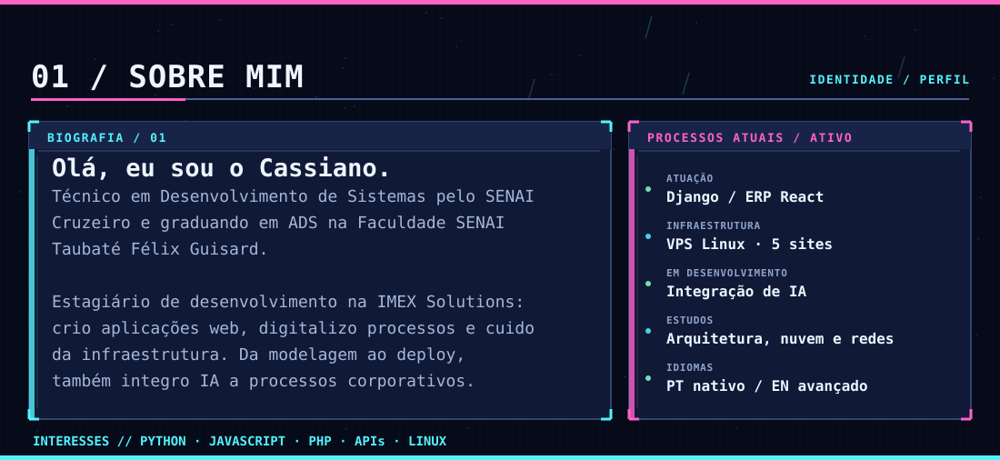
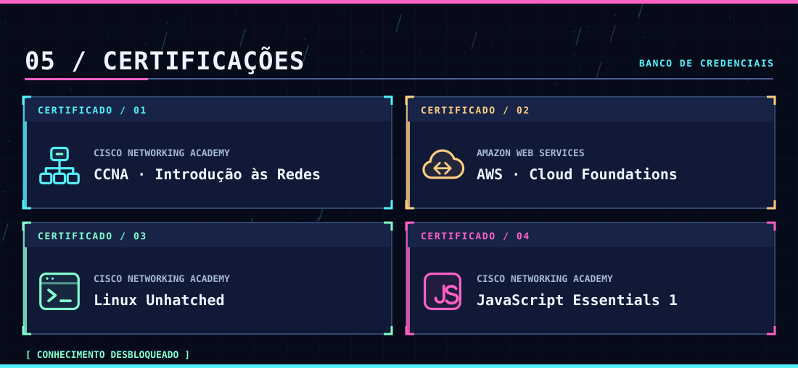
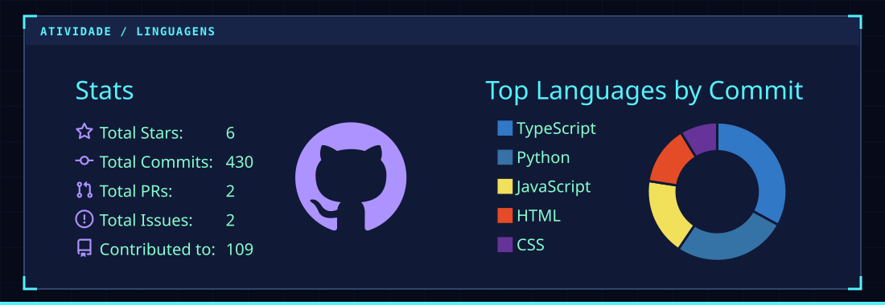
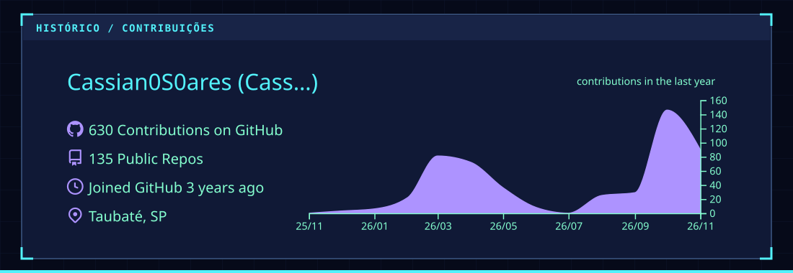

<!-- README de perfil · Neon Tokyo · SVGs animados em ./assets/ -->

  

<!-- Contatos: cada imagem SVG está dentro de um link clicável -->

  
  
  

  

<!-- Painéis gerados diariamente pelo workflow profile-stats, preservando os dados reais. -->

  

  

  

  

