<!-- README de perfil · Neon Tokyo · SVGs animados em ./assets/ -->

  

<!-- Contatos: cada imagem SVG está dentro de um link clicável -->

  
  
  

  

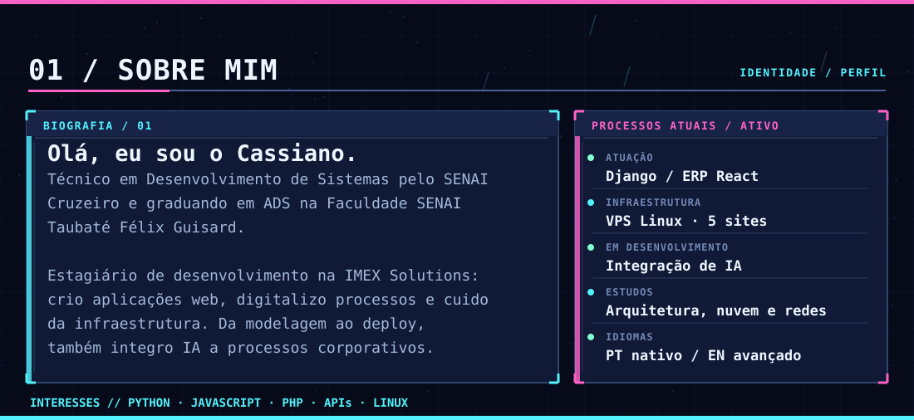

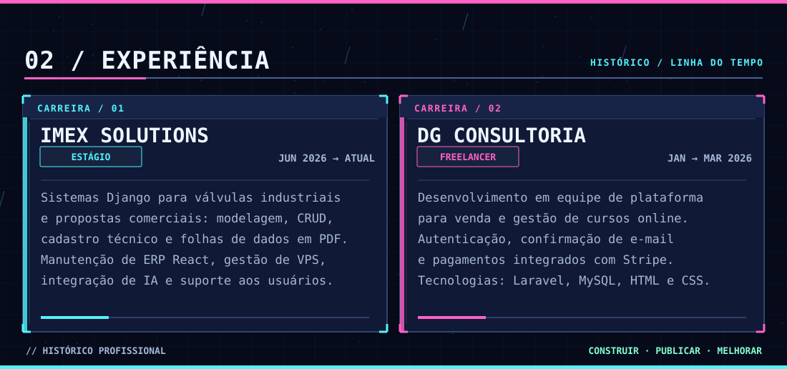

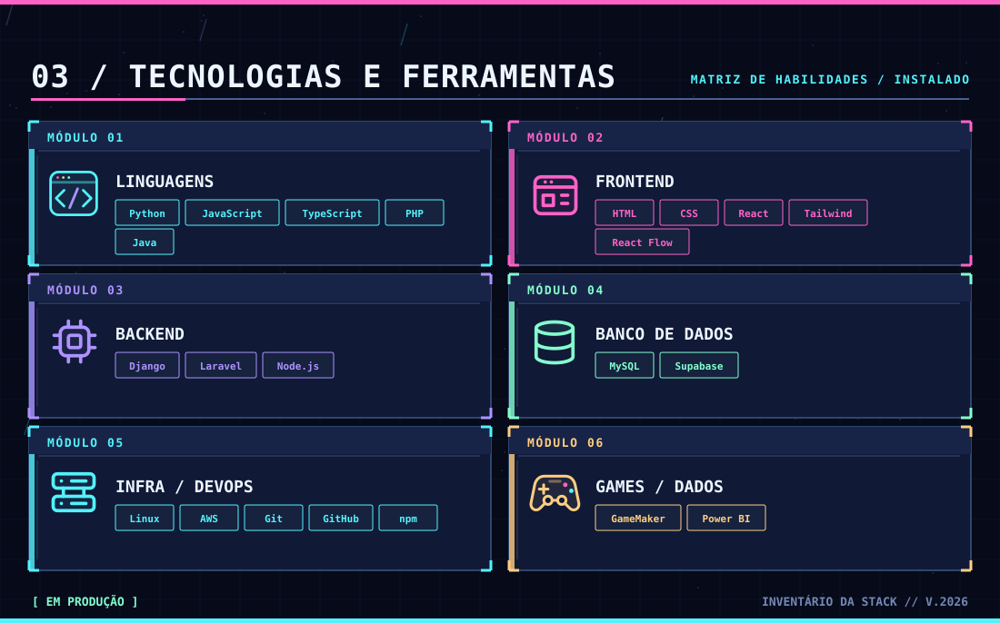

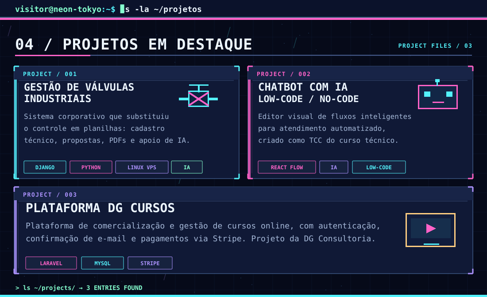

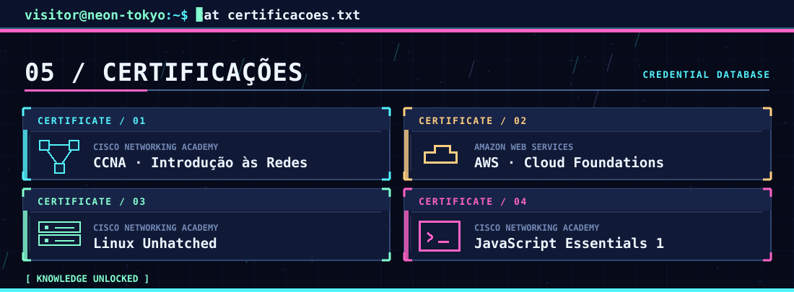

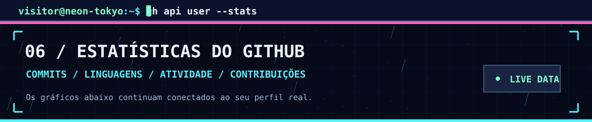
<!-- Estatísticas reais: dependem da pasta profile-summary-card-output e da ação do GitHub Snake -->

  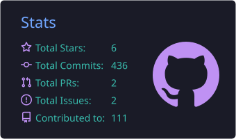
  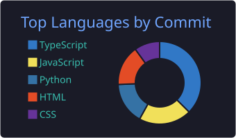

  

  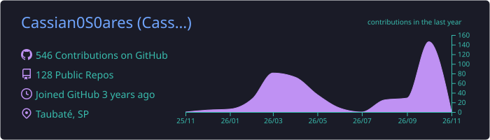

  

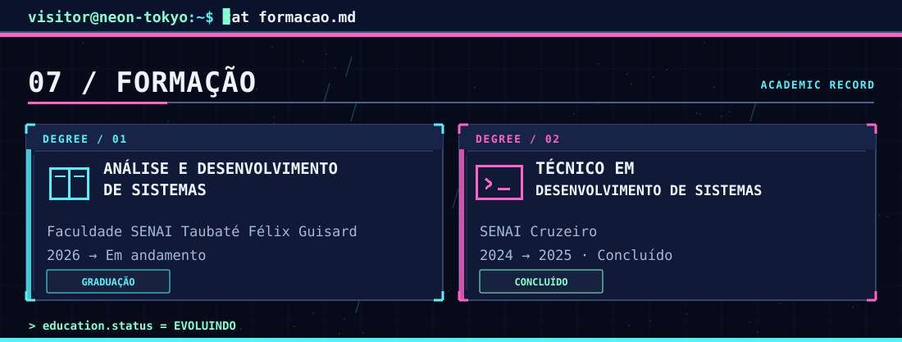

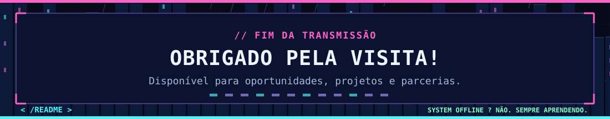
